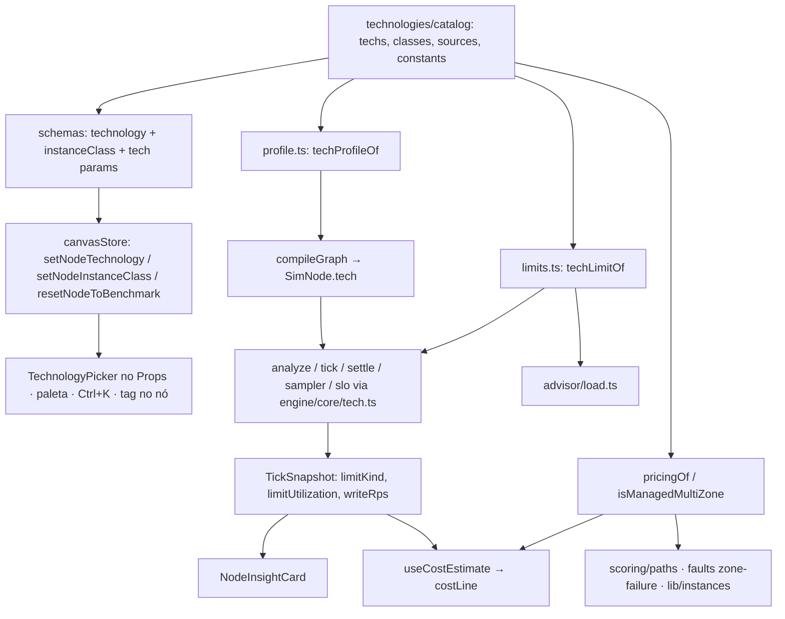

# Tecnologias dos componentes — Design

**Spec**: `.specs/features/component-technologies/spec.md`
**Context**: `.specs/features/component-technologies/context.md`
**Status**: Approved (2026-10-13)

Pesquisa de números (2026-10-12/13, com fontes) feita por agentes e resumida em [Tabela de tecnologias](#tabela-de-tecnologias). Os arquivos brutos ficaram no scratchpad da sessão; o que vale é o que entra em `src/domain/components/technologies/`, com fonte por linha.

---

## Architecture Overview

A tecnologia é um **parâmetro** do tipo (`params.technology`), e um único módulo de dados puro (`domain/components/technologies/`) é a fonte de verdade para números, preços, fontes, opções permitidas e constantes das mecânicas. Três consumidores leem esse módulo:

1. **Edição** (schema, store, Props, paleta): escolher a tecnologia ou a classe grava um preset nos params (capacidade, tempo de serviço, params da tecnologia). O motor continua lendo os params, como hoje.
2. **Motor**: `compileGraph` resolve um `TechProfile` (dados puros) por nó com tecnologia ≠ `generic`; `analyze()`, o tick, `settle`, `slo` e o sampler têm ganchos guardados por `node.tech` que caem na expressão atual quando ele não existe. O limite e a utilização do recurso limitante saem de uma função pura de `domain/` (`techLimitOf`), lida igual pelo motor e pelo advisor.
3. **Custo, scorer, faults**: `pricingOf(componentId, params)` substitui `getSchema(id).pricing`; `isManagedMultiZone(componentId, params)` substitui `MANAGED_MULTI_ZONE.has(id)`.



### Abordagens consideradas (motor)

| Abordagem                                                                      | Resumo                                                                                               | Por que não / por que sim                                                                                                                                                                                                                               |
| ------------------------------------------------------------------------------ | ---------------------------------------------------------------------------------------------------- | ------------------------------------------------------------------------------------------------------------------------------------------------------------------------------------------------------------------------------------------------------- |
| A. Transformação do nó antes da fila (estilo `faultView`)                      | Cada nó com tecnologia vira um nó efetivo: capacidade misturada, tempo médio, teto tipo rate limiter | Uma estação só não separa a fila de escrita da de leitura (mais instâncias aumentariam a vazão de escrita, contra TEC-26), a cauda fica exponencial (perde o p99 de QUORUM e do fan-out, TEC-30/36) e não falha uma classe sem a outra (S3 PUT vs GET). |
| B. Sub-nós virtuais no compile                                                 | Postgres vira roteador + estação de leitura + estação de escrita                                     | O roteador divide pelo read ratio global, não pelo mix do nó; quebra ids de métricas, faults, blast radius, cards de instância e a aba Flow; não expressa estatística de ordem nem partição quente.                                                     |
| **C. `TechProfile` compilado + fluxo por classe atrás de ganchos (escolhida)** | Dados por nó no `SimNode`, matemática em `engine/core/tech.ts`, ~10 ganchos guardados                | Fidelidade total, cada gancho é no-op provado para nós `generic` (golden intacto). Custo: mais pontos de integração no motor.                                                                                                                           |

---

## Code Reuse Analysis

### Existing Components to Leverage

| Component                                       | Location                                                 | How to Use                                                                                                                               |
| ----------------------------------------------- | -------------------------------------------------------- | ---------------------------------------------------------------------------------------------------------------------------------------- |
| Schema por tipo + `defineSchema`                | `src/domain/components/schemas/*.ts`, `define.ts`        | Recebe `technologySpec(id)`, `instanceClassSpec(id)` e os params novos; nenhum form por tipo.                                            |
| `sanitizeParams` / `resolvedParams`             | `src/domain/components/registry.ts:131,184`              | Ganha um passo `normalizeTechParams` depois da validação por chave (combinações inválidas por tecnologia).                               |
| `ParamsForm`                                    | `src/components/panel/ParamsForm.tsx`                    | Continua gerando o form; ganha `omitKeys` (o picker renderiza `technology`/`instanceClass`) e filtro de opções por `optionsFor(params)`. |
| `updateNodeParams` / undo                       | `src/store/canvasStore.ts`                               | Modelo das ações novas (uma entrada de undo, no-op em aba somente leitura).                                                              |
| `createComponentNode` / `placeNode`             | `src/lib/nodeFactory.ts`, `canvasStore`                  | Ganha `technology?`; paleta, Ctrl+K e DnD passam a tecnologia. `componentNodeWithId` (advisor) e `loadReference` seguem `generic`.       |
| `PaletteDndProvider`                            | `src/components/canvas/PaletteDnd.tsx`                   | `PaletteDragData` ganha `technology?`.                                                                                                   |
| `station`, `probSojournExceeds`, `sampleWaitMs` | `src/engine/core/queueing.ts`                            | Estações por classe usam as mesmas funções.                                                                                              |
| `writeShareOf` / `callProbability`              | `src/engine/faults/catalog.ts:186`, `core/routing.ts:86` | Base de `edgeWriteShare` (fração de escrita por aresta).                                                                                 |
| `consumerCapacity`                              | `src/engine/core/routing.ts:235`                         | Kafka: `min(consumers, instances, partitions)`.                                                                                          |
| `failoverSec` lido por `db-primary-failure`     | `src/engine/faults/catalog.ts:615`                       | TEC-27 sem mudar o motor: a tecnologia grava `failoverSec`.                                                                              |
| `nodeMetricsEqual`                              | `src/lib/runtimeMetrics.ts:25`                           | Campos novos do snapshot são primitivos planos para manter o compartilhamento.                                                           |
| `costLine` / `rightSize`                        | `src/cost/estimate.ts:67`, `cost/rightSize.ts`           | Passam a ler `pricingOf(componentId, params)`; `costLine` recebe `writeRps`.                                                             |

### Integration Points

| System                           | Integration Method                                                                                                                                |
| -------------------------------- | ------------------------------------------------------------------------------------------------------------------------------------------------- |
| Persistência (v4)                | `technology`/`instanceClass` e params novos vivem em `data.params`; param com padrão neutro não precisa de migração nem de `SCHEMA_VERSION` novo. |
| Golden (`engine-golden.test.ts`) | Nós sem tecnologia não ganham `tech`, nem campos novos no snapshot, nem warnings; a fixture não muda.                                             |
| Scorer/faults                    | `isManagedMultiZone` nos 3 pontos que hoje usam `MANAGED_MULTI_ZONE`.                                                                             |

---

## Components

### 1. Catálogo de tecnologias (dados)

- **Purpose**: fonte única de tecnologias, classes, números, preços, fontes, evidência e constantes das mecânicas.
- **Location**: `src/domain/components/technologies/` — `types.ts`, `sql.ts`, `nosql.ts`, `cache.ts`, `messaging.ts`, `edge.ts` (LB + API Gateway), `storage.ts` (Search + Object Storage), `index.ts`.
- **Interfaces** (`index.ts`):
  - `technologiesOf(componentId): readonly Technology[]` — sem `generic`, na ordem de exibição.
  - `getTechnology(componentId, techId): Technology | undefined`
  - `defaultTechnologyOf(componentId): string | undefined` — padrão de um nó novo (premissas).
  - `classOf(tech, classId?): TechClass | undefined` — a classe pedida ou a padrão.
  - `techPreset(componentId, techId, classId?): Params` — os params que a tecnologia (e a classe) definem.
  - `pricingOf(componentId, params): PricingSpec` — preço da tecnologia/classe ou o do schema para `generic`.
  - `isManagedMultiZone(componentId, params): boolean` — `MANAGED_MULTI_ZONE` ou tecnologia gerenciada.
  - `CENTRAL_TYPES` — os 10 tipos com tecnologia.
- **Dependencies**: `PARAM`, tipos de params. Puro, sem React; entra no bundle inicial (≈ 30 tecnologias, alguns KB gzip).
- **Reuses**: o formato de `PRICE_TABLE`/`PricingSpec`.

### 2. Integração com o schema

- **Purpose**: expor `technology`, `instanceClass` e os params de tecnologia no form gerado e na sanitização.
- **Location**: `src/domain/components/params.ts` (PARAM keys e builders), `types.ts` (`ParamSpec.optionsFor`), `registry.ts` (`normalizeTechParams`), schemas dos 10 tipos.
- **Interfaces**:
  - PARAM novos: `technology`, `instanceClass`, `prefixes` (S3), `readPreference`, `writeConcern` (MongoDB), `readConsistency` (DynamoDB). `shards` passa a existir também no `nosql-db` (MongoDB). Nenhuma chave existente é renomeada.
  - `technologySpec(componentId): ParamSpec` — enum `generic` + tecnologias; padrão `generic`.
  - `instanceClassSpec(componentId): ParamSpec` — enum com a união das classes do tipo, `optionsFor(p)` = classes da tecnologia, `visibleIf` = tecnologia cobrada por instância.
  - `ParamSpec.optionsFor?: (p: Params) => readonly string[]` — filtra opções no form (ex.: `lbAlgorithm` só `hash` no NLB).
  - `normalizeTechParams(componentId, params): Params` — chamado no fim de `sanitizeParams` só quando `technology ≠ generic`: classe fora da tecnologia → classe padrão (TEC-16); enum fora de `optionsFor` → padrão da tecnologia (TEC-39); params de mecânica fora da faixa → padrão da tecnologia (TEC-48).
  - `visibleIf` nos params de mecânica: `consistencyLevel`/`replicationFactor` só Cassandra/ScyllaDB, `readConsistency` só DynamoDB, `readPreference`/`writeConcern`/`shards` só MongoDB, `prefixes` só S3; `instances`/`capacityPerInstance` escondidos em tecnologia gerenciada (TEC-51). Em `generic` tudo fica como hoje.
- **Reuses**: `isValidParam`, `visibleIf`, `ParamGroup`.

### 3. Ações da store

- **Purpose**: trocar tecnologia/classe e voltar ao benchmark num passo de undo.
- **Location**: `src/store/canvasStore.ts` (+ `MUTATING_ACTIONS`).
- **Interfaces**:
  - `setNodeTechnology(nodeId, techId)` — no-op se igual (TEC-03) ou somente leitura (TEC-07); `generic` mantém os params (TEC-04); senão `{...params, ...techPreset(...)}` preservando `instances` e o que a tecnologia não define (TEC-02); uma entrada de undo.
  - `setNodeInstanceClass(nodeId, classId)` — mesmo contrato (TEC-15).
  - `resetNodeToBenchmark(nodeId)` — regrava o preset da tecnologia e classe atuais (TEC-44).
- **Reuses**: o padrão de `updateNodeParams` (push de histórico antes da mutação, guarda de somente leitura).

### 4. TechnologyPicker (Props)

- **Purpose**: escolher tecnologia e classe e ver de onde vêm os números.
- **Location**: `src/components/panel/TechnologyPicker.tsx`, montado em `RightPanel.tsx` acima do `ParamsForm` para os 10 tipos.
- **Comportamento**: `<select>` de tecnologia (rótulo com camada/modo, TEC-06), `<select>` de classe (TEC-14), descrição de uma linha, texto de consistência/CAP, "Based on: <fonte>, <ano> (measured|derived|estimate)" com link (TEC-05), aviso "Replica technology differs from its primary (<x>)" (TEC-45), "Modified from <tech> <classe>" + "Reset to benchmark" (TEC-43). Desabilitado em aba somente leitura (TEC-07). Usa `styles.ts`.
- **Dependencies**: catálogo, ações da store, `useIsActiveTabReadOnly`.

### 5. Paleta, Ctrl+K e tag no nó

- **Purpose**: achar e criar nós por tecnologia.
- **Location**: `src/components/sidebar/ComponentPalette.tsx`, `src/components/canvas/PaletteDnd.tsx`, `src/components/CommandPalette.tsx`, `src/lib/nodeFactory.ts`, `src/components/canvas/nodes/ComponentNode.tsx`.
- **Comportamento**:
  - Cada tipo central ganha um botão "▸" (`aria-expanded`, fechado por padrão) que lista as tecnologias como itens arrastáveis/tocáveis (`data-palette-item="<type>:<tech>"`) (TEC-20/21). A busca da paleta casa também nomes de tecnologia e abre o tipo com as que casaram (TEC-23).
  - A entrada do tipo cria o nó com `defaultTechnologyOf(type)` (TEC-22).
  - Ctrl+K lista "Cassandra — NoSQL Database" etc. (TEC-23).
  - `createComponentNode(component, position, technology?)` aplica `techPreset`; sem `technology` = `generic` (referências e quick fixes não mudam).
  - O nó mostra a tag curta ("Cassandra", "ALB · L7") posicionada fora da caixa (absoluta, abaixo), `data-technology`, sem mudar as dimensões (TEC-24).

### 6. Perfil e limites (puro, em `domain/`)

- **Purpose**: traduzir params de tecnologia em dados que o motor e o advisor leem igual.
- **Location**: `src/domain/components/technologies/profile.ts`, `limits.ts`.
- **Interfaces**:
  - `techProfileOf(componentId, params): TechProfile | undefined` — `undefined` para `generic`; prende entradas (RF 1–7, k ≤ RF, shards 1–1024, prefixes 1–1000, custos ≥ 1e-6, capacidades finitas positivas).
  - `techLimitOf(profile, core, demand: {read, write}): TechLimit` — `{ kind, utilization, capacityRps, scalesWithInstances }`, utilização = demanda oferecida ÷ capacidade de cada recurso, o maior vence (desempate em ordem fixa).
  - `LIMIT_LABELS: Record<TechLimitKind, string>` — "Write primary", "Hot partition", "Replica operations", "Primaries", "Query capacity", "S3 prefix limit", "Account throttle", "Queue throughput", "Consumers", "Consumers capped by partitions", "Capacity".

### 7. Motor (`engine/core/tech.ts` + ganchos)

- **Purpose**: aplicar as mecânicas só em nós com `tech`.
- **Location**: novo `src/engine/core/tech.ts`; ganchos em `domain/graph/compile.ts`, `engine/analyze.ts`, `core/tick.ts`, `core/settle.ts`, `core/sampler.ts`, `core/slo.ts`, `core/routing.ts`, `engine/types.ts`, `engine/snapshot.ts`.
- **Interfaces** (`tech.ts`): `edgeWriteShare`, `admit` (cota, partição quente, token bucket), `techSteadyFlow`, `techTickFlow`, `classTail`/`techExceeds`/`hopExceeds`, `techPercentileMs`, `sampleClassMs`, `kafkaLimit`.
- Detalhe em [Mecânicas](#mecânicas-no-motor).

### 8. Custo

- **Location**: `src/cost/estimate.ts`, `src/cost/rightSize.ts`, `src/components/cost/useCostEstimate.ts`, `src/components/panel/CostPanel.tsx`, `src/domain/components/pricing.ts`.
- **Comportamento**: `costLine(node, rps, writeRps?)` usa `pricingOf`. Provisionada: `instances × perInstanceHour × 730` (TEC-17). Gerenciada: preço fixo por recurso (não multiplica `instances`, TEC-51) + `readRps × perMillionReads + writeRps × perMillionWrites` (TEC-18), com `writeRps` do snapshot e, sem ele, o read ratio resolvido. O CostPanel mostra tecnologia, classe e `assumptions` da linha (TEC-19). `PRICE_TABLE.version` 2, `asOf: "2026-10"` (TEC-13).

### 9. Advisor, scorer e faults

- `advisor/load.ts:41` — nó com tecnologia: utilização = `techLimitOf(...)` com a mesma demanda (`writeRps` médio da janela); para Kafka, o número do motor. Sem fix de instâncias quando `!scalesWithInstances` (primário de escrita, partição quente, cotas, consumidores presos por partições); título e texto nomeiam o recurso (TEC-42).
- `scoring/paths.ts:17`, `engine/faults/catalog.ts:341`, `lib/instances.ts:78` — `isManagedMultiZone(componentId, params)` (TEC-50).
- `compile.ts` — warnings só em nós com tecnologia: "RF > instances" e réplica com tecnologia diferente do primário (TEC-45).

### 10. NodeInsightCard

- Quando o snapshot do nó traz `limitKind` e `limitUtilization ≥ 1`, mostra "<label>: <n>%" com ícone e cor de status (TEC-40). Abaixo de 1, mostra o recurso limitante sem destaque.

---

## Data Models

```typescript
// src/domain/components/technologies/types.ts
type Evidence = "measured" | "derived" | "estimate";

interface TechSource {
  title: string;
  url: string;
  year: number;
}

interface TechClass {
  id: string; // "db.r6g.xlarge"
  vCpu: number;
  capacityPerInstance: number; // req/s (leituras, consultas ou ops de réplica, conforme a tecnologia)
  serviceTimeMs: number;
  perInstanceHour: number;
  params?: Params; // ex.: writeCapacityRps, writeServiceTimeMs
  evidence: Evidence;
}

interface Technology {
  id: string; // "postgres"
  componentIds: readonly string[]; // ["sql-db", "read-replica"]
  label: string; // "PostgreSQL (RDS)"
  short: string; // "Postgres"
  layer?: "L4" | "L7";
  description: string; // uma linha, propósito
  consistency: string; // uma linha, CAP/consistência
  billing: "instance" | "managed";
  classes?: readonly TechClass[]; // billing "instance"
  defaultClass?: string;
  managed?: {
    // billing "managed"
    capacityPerInstance: number;
    serviceTimeMs: number;
    evidence: Evidence;
    perHour?: number;
    baseMonthly?: number;
    perMillionReads: number;
    perMillionWrites: number;
  };
  params: Params; // failoverSec, timeoutMs, partitions, consistencyLevel, ...
  options?: Partial<Record<string, readonly string[]>>; // enums restritos (lbAlgorithm)
  mechanics?: TechMechanics; // constantes lidas por techProfileOf
  sources: readonly TechSource[];
  assumptions: string; // carga do benchmark, normalização, o que fica de fora
}

interface TechMechanics {
  kind:
    | "sql-primary"
    | "replica-quorum"
    | "dynamo"
    | "mongo"
    | "search-fanout"
    | "quota"
    | "kafka"
    | "none";
  perPartition?: { readUnits: number; writeUnits: number }; // DynamoDB 3000/1000
  readUnitCost?: { eventual: number; strong: number }; // 0.5 / 1
  quota?: {
    readRps?: number;
    writeRps?: number;
    sharedRps?: number;
    burst?: number;
    perPrefix?: boolean;
  };
  replicationRttMs?: number; // MongoDB w:majority
  queryPerNode?: never; // Search usa capacityPerInstance da classe
  indexCostPerDoc?: number; // Search: custo de uma escrita em consultas-equivalentes por cópia
}
```

`TechProfile` (resolvido por nó, em `SimNode.tech`), `ClassRoute`, `LatencyShape` e `TechLimitKind` seguem a proposta do agente de motor (registrada na seção de mecânicas). Campos novos de snapshot: `NodeSteadyState`/`NodeRuntimeMetrics` ganham `limitKind?`, `limitUtilization?`, `writeRps?` (primitivos, presentes só em nós com tecnologia).

---

## Mecânicas no motor

Notação: λ oferecido ao nó, ws a fração de escrita do nó (λ_w = λ·ws, λ_r = λ − λ_w), n = `instances`, k₀ = `capacityPerInstance`, S₀ = `serviceTimeMs` (já com faults). Números de máquina escalam com `capScale = k₀/base.k₀` e `timeScale = S₀/base.S₀` (exatamente 1 sem fault), então faults como `iops-throttle` afetam o primário sem mexer em `faultView`. Cotas gerenciadas não escalam.

| Mecânica                                         | Fórmula                                                                                                                                                                                                                                                                                    | Requisito    |
| ------------------------------------------------ | ------------------------------------------------------------------------------------------------------------------------------------------------------------------------------------------------------------------------------------------------------------------------------------------ | ------------ |
| Primário SQL                                     | Estação 0 = (n, k₀, S₀) atende leituras; primário = (`shards`, `writeCapacityRps`·capScale, `writeServiceTimeMs`·timeScale) atende escritas; `maxQueue` por estação                                                                                                                        | TEC-25/26    |
| Quorum (Cassandra, ScyllaDB)                     | k = 1, ⌊RF/2⌋+1, RF; estação de ops de réplica (n, k₀, S₀); leitura custa k e tem latência = k-ésimo de RF; escrita custa RF e espera k acks (mesma forma)                                                                                                                                 | TEC-29/30    |
| Partição quente                                  | Demanda em unidades na partição quente U = h·(λ_r·c_r + λ_w·c_w) ÷ C_p; se U > 1, só a partição quente perde: throttled = h·λ·(1 − 1/U). DynamoDB: C_p = 3000 RCU / 1000 WCU, c_r = 0,5 (eventual) ou 1 (forte), c_w = 1. Cassandra/Scylla: C_p = min(RF, n)·k₀·capScale em ops de réplica | TEC-28/31    |
| MongoDB                                          | s = `shards`, m = n/s membros por shard; primários (s, k₀, S₀) atendem escritas e leituras com `primary`; com `secondaryPreferred` as leituras vão para os n − s secundários (os primários se n = s); `majority` soma `replicationRttMs` à escrita                                         | TEC-32       |
| OpenSearch                                       | Leitura (consulta) com latência = máx de `shards` amostras; capacidade de consulta = min(n, shards·(replicas+1))·k₀ ÷ shards; escrita custa (replicas+1)·`indexCostPerDoc`                                                                                                                 | TEC-36       |
| Kafka                                            | `pullers = max(1, min(consumers, target.instances, partitions))`                                                                                                                                                                                                                           | TEC-34       |
| Cotas (S3, API Gateway, SQS FIFO, RabbitMQ, SNS) | S3: a_r = min(λ_r, 5500·P), a_w = min(λ_w, 3500·P); API Gateway: L = 10.000 req/s e burst 5.000 (analyze: min(λ, L); tick: token bucket); SQS FIFO/RabbitMQ/SNS: L da tabela; excesso = erro                                                                                               | TEC-35/37/38 |
| Limite reportado                                 | `techLimitOf` sobre a demanda **oferecida**; `utilization` do nó = `limitUtilization`, então status, gargalo, badges e score seguem o recurso limitante                                                                                                                                    | TEC-40/41/42 |

**Sampler.** `SampleNode.tech = { read, write }`; a classe vem do `isRead` que o sampler já sorteia por requisição. Formas: `one` = Exp(S) + espera; `kth(k, n)` pela representação de Rényi (k sorteios, k ≤ 7); `max(n)` pela CDF inversa (1 sorteio para qualquer n). Para nós `generic` a ordem e o número de sorteios são os mesmos de hoje (teste com `countingRng`).

**Settle e SLO.** Timeouts e sucesso de chamada para nó com tecnologia usam a mistura por classe com a fração de escrita da aresta; `throttled` entra em `dropped` e o status vira `critical`. Percentis por bissecção com 64 iterações fixas (determinístico, monótono em p). Para nós `generic` as expressões e a ordem das multiplicações não mudam.

**Tick.** `NodeState.tech = { primaryBacklog, tokens }`, zerado quando a tecnologia muda; só o trecho de capacidade/fila (`tick.ts:315-363`) ganha o desvio `techTickFlow`; o código genérico não é refatorado.

Decisões de fidelidade (do agente de motor, decididas aqui):

| #   | Questão                                   | Escolha                                                               | Motivo                                                                      |
| --- | ----------------------------------------- | --------------------------------------------------------------------- | --------------------------------------------------------------------------- |
| D1  | Forma da latência de escrita no Cassandra | k-ésimo de RF (o CL vale para escrita também)                         | É o comportamento real: o coordenador espera CL acks.                       |
| D2  | Throttle da partição quente               | Só as requisições da partição quente falham: h·λ·(1 − 1/U)            | As outras partições têm folga; o proporcional ensinaria errado.             |
| D3  | Espera nas estatísticas de ordem          | Uma espera compartilhada + estatística de ordem dos tempos de serviço | Fecha com a cauda analítica e custa O(RF).                                  |
| D4  | MongoDB `secondaryPreferred`              | Leituras nos n − s secundários                                        | Evita contar o primário duas vezes; fonte: capacidade ≈ (membros − 1) × nó. |
| D5  | Utilização no tick                        | Pela demanda oferecida, igual ao analyze                              | Mesmo número no analyze, no tick e no advisor (TEC-41/42).                  |

---

## Tabela de tecnologias

Preços AWS us-east-1 on-demand (lidos em 2026-10-12, price list da AWS). Evidência: **M** medido na fonte, **D** derivado de medição com a normalização escrita, **E** estimativa sem benchmark publicado (o Props mostra "estimate").

### SQL Database e Read Replica (cobrança por instância; classes db.r6g)

| Tecnologia                        | Classe                             | Leitura req/s · ms            | Escrita req/s · ms          | $/h                           | failoverSec               | Evid.                                  |
| --------------------------------- | ---------------------------------- | ----------------------------- | --------------------------- | ----------------------------- | ------------------------- | -------------------------------------- |
| PostgreSQL (RDS)                  | large / xlarge / 2xlarge / 4xlarge | 20k / 40k / 80k / 160k · 0,10 | 3k / 5k / 8k / 12k · 1,5    | 0,225 / 0,45 / 0,899 / 1,798  | 90 (Multi-AZ 60–120 s, M) | D (leitura/escrita), E (ms de escrita) |
| MySQL (RDS)                       | idem                               | 24k / 48k / 96k / 190k · 0,08 | 1,5k / 3k / 5k / 8k · 2,0   | 0,215 / 0,43 / 0,859 / 1,718  | 90                        | D, E                                   |
| Aurora PostgreSQL (I/O-Optimized) | idem                               | 18k / 36k / 72k / 145k · 0,11 | 2,5k / 5k / 10k / 20k · 3,0 | 0,338 / 0,675 / 1,349 / 2,699 | 30 (M)                    | D                                      |

Leituras ≈ 10k (PG) / 12k (MySQL) point selects por vCPU Graviton2; escritas = 2 × TPC-B (pgbench) ou ÷ 2 das row-writes (sysbench), com gp3 3.000 IOPS nas classes pequenas e ≥ 400 GiB (12.000 IOPS) nas grandes. Read Replica: mesmas tecnologias e classes, `replicationLagMs` 100 (RDS, E) e 20 (Aurora, "usually much less than 100 ms", M). Padrão: xlarge.

### NoSQL Database

| Tecnologia            | Cobrança   | Classe                                 | Capacidade · ms                                       | $/h ou preço                      | Mecânica                                                      | Evid.                                                                                     |
| --------------------- | ---------- | -------------------------------------- | ----------------------------------------------------- | --------------------------------- | ------------------------------------------------------------- | ----------------------------------------------------------------------------------------- |
| DynamoDB (on-demand)  | gerenciada | —                                      | cota 40.000 RRU e 40.000 WRU por tabela · 3 ms        | $0,125/M RRU, $0,625/M WRU        | partição 3.000 RCU / 1.000 WCU; eventual 0,5 RRU, forte 1 RRU | M (preço, limites), E (ms)                                                                |
| Cassandra             | instância  | i4i.large / xlarge / 2xlarge / 4xlarge | 5k / 16k / 32k / 67k ops de réplica/s · 1,5           | 0,172 / 0,343 / 0,686 / 1,373     | quorum, RF 3 (1–7)                                            | D (âncora i4i.4xlarge 27k ops cliente/nó a RF 3 QUORUM 50/50 × 2,5 ops de réplica por op) |
| ScyllaDB              | instância  | idem                                   | 25k / 57k / 115k / 232k · 0,7                         | idem                              | quorum, RF 3                                                  | D (âncora 93k/nó em i4i.4xlarge)                                                          |
| MongoDB (replica set) | instância  | r6g.large / xlarge / 2xlarge / 4xlarge | 7k / 14k / 24k / 40k ops/s por membro · 0,7 (leitura) | 0,1008 / 0,2016 / 0,4032 / 0,8064 | primários/secundários, `majority` +2 ms                       | M (m5: 14k/24k), E (r6g e +2 ms)                                                          |

Padrões: Cassandra/Scylla i4i.xlarge, MongoDB r6g.xlarge com 3 membros e 1 shard, `primary`, `majority`.

### Load Balancer e API Gateway

| Tecnologia                 | Cobrança   | Classe                                 | Capacidade · ms                            | Preço                                          | Algoritmos                                                          | Evid.                                           |
| -------------------------- | ---------- | -------------------------------------- | ------------------------------------------ | ---------------------------------------------- | ------------------------------------------------------------------- | ----------------------------------------------- |
| AWS NLB (L4)               | gerenciada | —                                      | 1.000.000 · 0,1                            | $0,0225/h + ≈ $0,025/M (NLCU, 4 KB)            | hash (flow hash 5-tupla)                                            | M (preço, algoritmo), E (ms)                    |
| AWS ALB (L7)               | gerenciada | —                                      | 1.000.000 · 2                              | $0,0225/h + ≈ $0,033/M (LCU, 4 KB, keep-alive) | round-robin, least outstanding (least-connections), weighted random | M, E (ms)                                       |
| HAProxy (L7)               | instância  | c6g.large / xlarge / 2xlarge / 4xlarge | 20k / 35k / 70k / 140k (rede a 4 KB) · 0,4 | 0,068 / 0,136 / 0,272 / 0,544                  | todos                                                               | D (2,04 M req/s em c6gn.16xlarge; teto de rede) |
| Envoy (L7)                 | instância  | idem                                   | 20k / 35k / 70k / 140k · 0,5               | idem                                           | todos                                                               | E (sem benchmark oficial)                       |
| AWS API Gateway (HTTP API) | gerenciada | —                                      | cota 10.000 req/s, burst 5.000 · 8         | $1,00/M                                        | —                                                                   | M (preço, cota, timeout 30 s), E (ms)           |
| Kong                       | instância  | c6g.large / xlarge / 2xlarge / 4xlarge | 18k / 36k / 72k / 144k · 1,5               | 0,068 / 0,136 / 0,272 / 0,544                  | —                                                                   | D (144k req/s em c5.4xlarge, sem plugins)       |

### Search e Object Storage

| Tecnologia  | Cobrança   | Classe                                         | Capacidade · ms                                      | Preço                         | Mecânica                      | Evid.                                                                   |
| ----------- | ---------- | ---------------------------------------------- | ---------------------------------------------------- | ----------------------------- | ----------------------------- | ----------------------------------------------------------------------- |
| OpenSearch  | instância  | r6g.large / xlarge / 2xlarge / 4xlarge .search | 500 / 1.000 / 2.000 / 4.000 consultas de shard/s · 3 | 0,167 / 0,335 / 0,669 / 1,339 | fan-out, shards 5, replicas 1 | E (capacidade), M (preço, fan-out p90 3,4 → 6,45 ms de 1 para 3 shards) |
| S3 Standard | gerenciada | —                                              | 5.500 GET e 3.500 PUT por prefixo · 30               | $0,40/M GET, $5,00/M PUT      | prefixos (1–1.000)            | M (limites, preço), D (ms: "tens of ms" para < 512 KB)                  |

### Cache, Message Queue e Pub/Sub

| Tecnologia               | Cobrança           | Classe                                       | Capacidade · ms                                                                      | Preço                                                                      | Mecânica                                             | Evid.                                                                                    |
| ------------------------ | ------------------ | -------------------------------------------- | ------------------------------------------------------------------------------------ | -------------------------------------------------------------------------- | ---------------------------------------------------- | ---------------------------------------------------------------------------------------- |
| Redis (ElastiCache)      | instância          | cache.r6g.large / xlarge / 2xlarge / 4xlarge | 85k / 142k / 284k / 568k ops/s · 0,4                                                 | 0,206 / 0,411 / 0,821 / 1,642                                              | nenhuma (hit rate segue param)                       | D: mín(CPU, rede a 1 KB); CPU M em xlarge (349k, Redis 7.0), rede derivada da banda base |
| Memcached (ElastiCache)  | instância          | idem                                         | 85k / 142k / 284k / 568k · 0,4                                                       | idem                                                                       | nenhuma                                              | D (rede manda a 1 KB; CPU M só em 2xlarge, 395k)                                         |
| Kafka (MSK)              | instância (broker) | kafka.m7g.large / xlarge / 2xlarge / 4xlarge | 21k / 41,7k / 66,7k / 66,7k msgs/s por broker · 5                                    | 0,204 / 0,408 / 0,816 / 1,632                                              | consumidores ≤ partições (6 por padrão)              | M (fórmula de sizing da AWS, 1 KB, RF 3, 2 consumer groups), E (ms)                      |
| RabbitMQ (Amazon MQ)     | instância (broker) | mq.m7g.large / xlarge / 2xlarge / 4xlarge    | 19,5k / 39k / 78k / 185k msgs/s por broker · 25; teto por fila 15k / 20k / 20k / 20k | 0,2734 / 0,5467 / 1,0934 / 2,1869                                          | teto por fila (quorum queue, 1 KB)                   | E (AWS só publica relativos; âncoras de benchmark single-node)                           |
| SQS Standard             | gerenciada         | —                                            | 1.000.000 · 20                                                                       | $1,20 por milhão de mensagens (send + receive + delete a $0,40/M requests) | nenhuma                                              | M (preço, "nearly unlimited"), E (ms)                                                    |
| SQS FIFO                 | gerenciada         | —                                            | cota 3.000 msgs/s (lotes de 10, sem high-throughput mode) · 25                       | $1,50 por milhão de mensagens ($0,50/M × 3)                                | cota                                                 | M (cota, preço), E (ms)                                                                  |
| SNS                      | gerenciada         | —                                            | cota 30.000 publishes/s (us-east-1, soft) · 20                                       | $0,50/M publishes; entrega a SQS/Lambda sem custo                          | cota                                                 | M (cota, preço), E (ms)                                                                  |
| Kafka (MSK) como Pub/Sub | instância          | como Kafka                                   | como Kafka                                                                           | como Kafka                                                                 | fan-out por consumer group; consumidores ≤ partições | M                                                                                        |

Padrões: Redis cache.r6g.xlarge, Kafka kafka.m7g.xlarge com 6 partições, RabbitMQ mq.m7g.xlarge. SQS e SNS sem classe. Limites novos que o material antigo não tem: SQS aceita mensagens de até 1 MiB e FIFO 120k em voo (as premissas citam as datas).

---

## Error Handling Strategy

| Error Scenario                                | Handling                                                  | User Impact                                            |
| --------------------------------------------- | --------------------------------------------------------- | ------------------------------------------------------ |
| `technology` salvo desconhecido               | `sanitizeParams` → `generic`                              | O nó abre como Generic com os números atuais.          |
| `instanceClass` de outra tecnologia           | `normalizeTechParams` → classe padrão da tecnologia       | O Props mostra a classe padrão.                        |
| Param de mecânica fora da faixa               | padrão da tecnologia; `techProfileOf` prende de novo      | Resultado finito, served ≤ offered.                    |
| Algoritmo de LB não suportado pela tecnologia | padrão da tecnologia (`hash` no NLB)                      | O select só mostra os suportados.                      |
| Réplica com tecnologia diferente do primário  | warning do compilador + aviso no Props                    | Simula normalmente.                                    |
| RF > instances (Cassandra/Scylla)             | warning do compilador; a partição usa min(RF, n) réplicas | Aviso no painel de simulação.                          |
| Cota excedida / partição quente               | `throttled` conta como erro; status `critical`            | Card mostra o recurso e a %; advisor nomeia o recurso. |
| Troca de tecnologia em aba somente leitura    | no-op                                                     | Seletores desabilitados.                               |

---

## Risks & Concerns

| Concern                                                                                       | Location (file:line)                                 | Impact                                                                                               | Mitigation                                                                                                                       |
| --------------------------------------------------------------------------------------------- | ---------------------------------------------------- | ---------------------------------------------------------------------------------------------------- | -------------------------------------------------------------------------------------------------------------------------------- |
| Golden hash inclui `warnings` e todo campo do snapshot                                        | `tests/unit/engine-golden.test.ts:120-135`           | Qualquer campo `undefined` explícito, warning novo ou sorteio a mais em nó `generic` quebra o golden | Campos opcionais por spread condicional; warnings só para nós com tecnologia; teste com `countingRng`; nunca regravar a fixture. |
| `sanitizeParams` congela params antes inertes (`consistencyLevel`, `shards`…) na fixture      | `registry.ts:131`, fixture                           | Ligar esses params em `generic` mudaria todo resultado                                               | Mecânicas só com `technology ≠ generic`.                                                                                         |
| `nodeMetricsEqual` compara por campo com `Object.is`                                          | `src/lib/runtimeMetrics.ts:25`                       | Objeto aninhado no snapshot re-renderizaria todo nó a cada tick                                      | Só primitivos planos (`limitKind`, `limitUtilization`, `writeRps`).                                                              |
| Advisor oferece "scale out" para limite que não escala com instâncias                         | `src/advisor/load.ts:41-113`                         | Conselho errado (ex.: API Gateway na cota)                                                           | `scalesWithInstances` em `TechLimit`; sem fix de instâncias nesses casos.                                                        |
| `api-gateway` gerenciado com `instances = 1` perderia pontos de escalabilidade e viraria SPOF | `src/scoring/paths.ts:17`, `rules/scalability.ts:96` | Score injusto                                                                                        | `isManagedMultiZone` (TEC-50).                                                                                                   |
| E2E que arrastam um tipo central passam a criar nós com tecnologia (outros números)           | `tests/e2e/*.spec.ts`, helper `quickAdd`             | Asserções numéricas podem mudar                                                                      | Rodar a suíte e2e inteira (regra L-014); onde o teste depende do número genérico, escolher `generic` explicitamente no teste.    |
| Tick ganha um caminho paralelo de fluxo para nós com tecnologia                               | `src/engine/core/tick.ts:315-363`                    | Duplicação pequena do passo de fila                                                                  | Aceita; unificar depois com o golden como guarda.                                                                                |
| Números derivados/estimados apresentados como fato                                            | dados do catálogo                                    | Conteúdo que ensina errado                                                                           | Campo `evidence` por linha, exibido no Props; `catalog.test.ts` exige fonte, premissas e evidência.                              |
| Instâncias em SQL com tecnologia                                                              | premissas                                            | `instances` significa "primário + cópias legíveis", não Multi-AZ standby                             | Texto de `assumptions` explica; Multi-AZ e preço Multi-AZ fora do escopo.                                                        |

---

## Tech Decisions (only non-obvious ones)

| Decision                            | Choice                                                                    | Rationale                                                                         |
| ----------------------------------- | ------------------------------------------------------------------------- | --------------------------------------------------------------------------------- |
| Onde mora a tecnologia              | `params.technology` + catálogo puro em `domain/components/technologies/`  | Decisão do usuário; um lugar só para números, preços e fontes.                    |
| Preset vs referência                | Trocar tecnologia grava valores nos params (preset); o motor lê os params | Mantém o motor lendo params, deixa o usuário ajustar depois e não exige migração. |
| Validação dependente de outro param | `ParamSpec.optionsFor` + `normalizeTechParams` no fim de `sanitizeParams` | Opções de enum hoje são estáticas; classe e algoritmo dependem da tecnologia.     |
| Fonte do preço                      | `pricingOf(componentId, params)`                                          | Custo, right-size e score precisam do preço por tecnologia/classe.                |
| Gerenciado multi-AZ                 | `isManagedMultiZone(componentId, params)`                                 | Tecnologias gerenciadas não são SPOF nem caem com uma zona.                       |
| Advisor/referências                 | Quick fixes e referências seguem `generic`                                | Nada nas 35 referências nem no `advisor.test.ts` muda nesta spec.                 |

> Decisão de projeto registrada em `.specs/STATE.md` como **AD-005**.

---

## Apêndice A — Detalhe do motor (proposta do agente de design, com D1–D5 aplicadas)

Texto da proposta revisada, em inglês como foi escrita, conferida contra o código em 2026-10-12. Onde a proposta original diferia das decisões D1–D5, vale a decisão (marcado **[D#]**).

### A.0 Findings that shape the design

1. `tests/unit/engine-golden.test.ts:120-135` hashes the whole `analyze()` output (every `NodeSteadyState`) and `projectTick` (every `s.nodes`, `s.edges`); `canonical()`/`JSON.stringify` drop `undefined`. New optional fields are safe only if **absent** on generic nodes; any new compiler warning on a generic graph changes the hash (`steady.warnings` is in it).
2. Params are not hashed. `sanitizeParams` gives every node every schema key; frozen inert params (`consistencyLevel`, `hotPartitionShare`, `shards`…) stay inert as long as nothing reads them for generic nodes.
3. Read/write class exists only in the sampler (`isRead`, `sampler.ts:383`). Flows are class-blind: `callProbability` (`routing.ts:86-110`) uses the global read ratio `r`. The per-node split is derived **alongside** edge loads, never by changing them.
4. Faults rewrite only `capacityPerInstance` and `serviceTimeMs` (`faultView.ts:22-40`); technology numbers are stored relative to them (`base`), so faults scale them and `faultView` stays untouched.
5. `nodeMetricsEqual` (`lib/runtimeMetrics.ts:25-30`) compares fields with `Object.is`: new snapshot fields must be flat primitives.
6. `advisor/load.ts:41-44` computes its own utilization (rpsIn ÷ instances × capacity); `api-gateway` is `stateful: false`, so it would get "Scale out" at its account throttle.
7. `db-primary-failure` already reads `PARAM.failoverSec` (`faults/catalog.ts:615`): TEC-27 needs no engine change.
8. `sampleExponential` returns 0 without drawing when `mean ≤ 0` (`rng.ts:22-26`): matters for draw counting.

### A.1 `SimNode.tech?: TechProfile` (computed in `compile.ts`)

```ts
type LatencyShape =
  { kind: "one" } | { kind: "kth"; k: number; n: number } | { kind: "max"; n: number };
type TechLimitKind =
  | "capacity"
  | "read-capacity"
  | "write-primary"
  | "replica-ops"
  | "primaries"
  | "hot-partition"
  | "query-capacity"
  | "prefix-limit"
  | "account-throttle"
  | "queue-throughput"
  | "consumers"
  | "consumers-partitions";
interface ClassRoute {
  station: 0 | 1;
  cost: number;
  serviceScale: number;
  shape: LatencyShape;
  addMs: number;
}
interface TechProfile {
  technology: string;
  base: { capacityPerInstance: number; serviceTimeMs: number }; // runtime scale = node.x / base.x (exactly 1 without faults)
  classes?: {
    read: ClassRoute;
    write: ClassRoute;
    primary?: {
      instances: number;
      capacityPerInstance: number;
      serviceTimeMs: number;
      limit: TechLimitKind;
    };
    mainLimit: TechLimitKind;
  };
  throttle?:
    | {
        kind: "quota";
        limit: TechLimitKind;
        readRps: number;
        writeRps: number;
        sharedRps: number;
        burst?: number;
      }
    | {
        kind: "partition";
        share: number;
        readCost: number;
        writeCost: number;
        readUnits: number;
        writeUnits: number;
        nodeBound: boolean;
      };
  consumerCap?: number; // Kafka: partitions
}
```

- `techProfileOf` returns `undefined` for generic; clamps RF ∈ [1,7], k ∈ [1,RF], shards ∈ [1,1024], prefixes ∈ [1,1000], costs ≥ 1e-6, capacities finite positive. Never write `tech: undefined`.
- Types without mechanics (Redis, ALB, Kong…) get a profile with only `technology` and `base` (snapshot reports `limitKind: "capacity"`); every engine path stays generic for them.
- `capScale = node.capacityPerInstance / base.capacityPerInstance`, `timeScale = node.serviceTimeMs / base.serviceTimeMs`. Machine-bound numbers (primary, node-bound partition, class service times) scale; managed quotas (S3, API Gateway, SQS FIFO, SNS, DynamoDB per-partition units) don't. `kill-instances` on SQL also scales the primary by (n−1)/n (conservative, documented).

### A.2 Formulas (λ offered, ws write share, λ_w = λ·ws, λ_r = λ − λ_w, λ′ after fault errorRate, n/k₀/S₀ after faults)

- **SQL (TEC-25/26)**: station 0 = (n, k₀, S₀) reads, cost 1, shape one, limit `read-capacity`; primary = (shards, writeCapacityRps·capScale, writeServiceTimeMs·timeScale) writes, cost 1, limit `write-primary`. `maxQueueOf` per station.
- **Cassandra/ScyllaDB (TEC-29/30)**: k = 1, ⌊RF/2⌋+1, RF; station 0 = (n, k₀ replica-ops/s, S₀), limit `replica-ops`; reads cost k, shape kth(k, RF); writes cost RF, shape kth(k, RF) **[D1]**. Hot partition node-bound: U_p = h·(k·λ_r + RF·λ_w) / (min(RF, n)·k₀·capScale). Compile warning "RF > instances" (tech only).
- **DynamoDB (TEC-28/31)**: station 0 = (n, k₀, S₀), cost 1, shape one. Partition quota: U_p = h·(λ_r·c_r/3000 + λ_w·c_w/1000), c_r = 0.5 eventual / 1 strong, c_w = 1.
- **MongoDB (TEC-32)**: s = shards, m = n/s. Primary station (s, k₀·capScale, S₀) takes writes (cost `writeCost` = 1) and reads with `primary`; with `secondaryPreferred` reads go to a secondaries station of (n − s) members, or the primaries when n = s **[D4]**. `majority` adds `replicationRttMs` to writes. Hot shard: U_p = h·(λ_w + λ_r·[primary]) / (k₀·capScale) + h·λ_r·[secondaryPreferred] / (max(1, m − 1)·k₀·capScale).
- **OpenSearch (TEC-36)**: station 0 = (n, k₀, S₀) in shard-queries/s; a query costs `shards` shard-queries spread over min(n, shards·(replicas+1)) nodes ⇒ query capacity = min(n, shards·(replicas+1))·k₀ / shards; read shape max(shards); writes cost (replicas+1)·indexCostPerDoc, shape one.
- **S3 (TEC-37)**: P = prefixes; a_r = min(a_r⁰, 5500·P), a_w = min(a_w⁰, 3500·P); throttled = Σ(a_c⁰ − a_c); limit `prefix-limit`.
- **AWS API Gateway (TEC-38)**: L = 10,000, B = 5,000; analyze a = min(λ′, L); tick token bucket (starts full): tokens ← min(B, tokens + L·dt); admitted = min(λ′·dt, tokens)/dt; tokens −= admitted·dt. Limit `account-throttle`.
- **SQS FIFO, RabbitMQ, SNS (TEC-35)**: shared quota L from the table (RabbitMQ: the class `quota`), no burst; limit `queue-throughput`.
- **Kafka (TEC-34)**: `consumerCapacity` (`routing.ts:235-239`): `pullers = max(1, min(consumers, target.instances, queue.tech?.consumerCap ?? ∞))`.
- **Hot partition throttle [D2]**: when U_p > 1 only the hot partition loses: throttled = h·λ′·(1 − 1/U_p), split over classes in proportion to their share of the hot partition's demand.
- **Class-aware stations (analyze)**: per station s, λ_s = Σ_{c→s} a_c·cost_c; st_s = station(λ_s…); f_s = st_s.servedRps/λ_s (1 when λ_s = 0); served_c = a_c·f_{s(c)}; served = Σ served_c ≤ λ; dropP_c = 1 − served_c/λ_c (0 when λ_c = 0), including fault errorRate, throttle and overflow.
- **Limit (TEC-41)**: `techLimitOf(profile, core, {read, write})` in `domain/components/technologies/limits.ts` computes D_j/C_j on **offered** per-class demand for each station, quota and U_p; argmax with a fixed tie order; returns `{kind, utilization, capacityRps (λ/util, or nominal at the node's mix when λ = 0), scalesWithInstances}`. Kafka: the engine merges max over consumer edges of demand_e/pull_e, kind `consumers-partitions` when `consumerCap` binds, else `consumers`. For tech nodes `utilization` = `limit.utilization` (status, `isBottleneck`, badges, scoring and `toSimulationResult` follow). Offered-based in analyze and tick **[D5]**.

### A.3 Per-node read/write split

`edgeWriteShare(e, source, wsSource, callCtx)` in `core/tech.ts`: LB edge → wsSource; else Σ P(call)·calls·cw ÷ Σ P(call)·calls over `edgeCallsOf(e, source)`, cw = 1 for `writes`, 0 for `reads`/`on_miss`/`after_miss`, wsSource for `always`/`fraction`; total 0 → fall back on kinds like `writeShareOf` (`catalog.ts:186-203`). In `analyze.ts` and `tick.ts`: `needsSplit = nodes.some(n => n.tech?.classes || n.tech?.throttle)` once per graph (false ⇒ nothing new runs); `inflowWrite` next to `inflow` (entries add share × (1 − r); push adds amplified × ws_e; tick uses totals incl. pending retry generations, consumer edges use `drained`); node ws = inflowWrite/inflow (else 1 − r); `edgeWs: Map<edgeId, number>` for settle. Edge loads untouched.

### A.4 Throttle errors in settle and metrics

- `throttled` next to `rejected` in analyze `NodeFlow` (`dropped = offered − served` already includes it) and tick `TickFlow` (`dropped = min(arriving, rejected + overflow + refused + throttled)`).
- Status: analyze `throttled > 0` ⇒ `critical` + `isBottleneck`; tick `nodeStatus` adds `|| flow.throttled > 0`. The rate limiter's deliberate rejections stay "warning".
- `settle(topo, flows, shares, writeShare?)`: `FlowView.tech?: {ws, read, write}` with per class `{station, serviceTimeMs, shape, addMs, served, dropProbability}`. Timeouts for tech targets: (1 − ws_e)·tail_r(t) + ws_e·tail_w(t); generic targets keep `probSojournExceeds`. Call success for tech targets: `classServed(target.tech, ws_e) × downstream.get(target)`, `downstream` being a second running product kept only for tech nodes; the generic `s` keeps its exact multiplication order. Retries amplify throttled calls through the existing fixed point.
- `slo.ts:43`: `probSojournExceeds(flow.st, …)` → `hopExceeds(flow, t)` (identical for generic flows).

### A.5 Sampler

`SampleNode.tech?: {read: SampleClass; write: SampleClass}` built in `sampleNodesFor` (`settle.ts:190-202`) only when `flow.tech` exists. In `visit`:

```ts
const cls = node.tech ? (isRead ? node.tech.read : node.tech.write) : undefined;
if (rng() < (cls ? cls.dropProbability : node.dropProbability)) return { ok: false, ms: 0 };
let ms = cls
  ? sampleClassMs(cls, rng)
  : node.latencyShare >= 1 || rng() < node.latencyShare
    ? sampleServiceMs(node.station, rng) + sampleWaitMs(node.station, rng)
    : 0;
```

`sampleClassMs`: one = Exp(S) + wait + addMs; kth(k, n) Rényi = S·Σ_{j=1..k} E_j/(n−j+1) (E_j = `sampleExponential(rng, 1)`) + one shared wait + addMs **[D3]**; max(n) inverse CDF = S·(−ln(−expm1(ln u / n))) + wait + addMs (one draw for any n; u = 0 finite).

### A.6 Tails and percentiles

t′ = t − addMs, q = 1 − e^{−t′/S}: one = e^{−t′/S} + probWaitExceeds(st, t′ − S); kth = Σ_{j=0..k−1} C(n,j)·q^j·(1−q)^{n−j} + probWaitExceeds(st, t′ − S·Σ_{j=1..k} 1/(n−j+1)); max = 1 − exp(n·log1p(−e^{−t′/S})) + probWaitExceeds(st, t′ − S·H_n); clamp to [0,1]. Node tail = (1−ws)·tail_r + ws·tail_w; percentile by bisection, 64 fixed iterations on [0, waitCap + S·upperQuantile + addMs]; mean = Σ share_c·(S_c·E[Y_c] + W̄_c + addMs_c); `queueDepth` = Σ stations. Generic nodes keep `hopPercentileMs`.

### A.7 Tick

`NodeState.tech?: {technology, primaryBacklog, tokens}` reset in `setGraph` when the technology changes; class-0 station keeps `backlog`. The tech branch replaces only `tick.ts` lines ~315-363 (from `const capacity` to `flows.set`) when `node.tech?.classes || node.tech?.throttle`, calling `techTickFlow` (admission, fluid step per station mirroring `work/done/q/overflow`, per-class completions in proportion to op share). Queue routing (~386-417) stays shared. Generic tick code is not refactored. Export `BACKLOG_NOISE_SEC` and move `stableStation`/`backlogStation` to free functions.

### A.8 Snapshot and advisor

- `NodeSteadyState`/`NodeRuntimeMetrics` gain `limitKind?`, `limitUtilization?`, `writeRps?`, set only when `node.tech` exists (conditional spread); `steadyStateToSnapshot` copies them; tick sets them in the snapshot. Both call `techLimitOf` on the same per-class offered demand.
- Advisor: `AdvisorContext` gains `writeLoad?`/`limits?`; `recentLoad` averages `writeRps` and `limitUtilization`; `utilizationOf` for tech nodes = `techLimitOf(techProfileOf(...), core, {read: load − w, write: w}).utilization` (Kafka `consumers*`: the engine's number); no instance fix when `!scalesWithInstances`; title/detail name the resource.

### A.9 Risks the guards address

Golden: optional fields absent; no warnings on all-generic graphs; sampler ternary keeps draw order; generic `s` in settle keeps multiplication order; generic tick lines not refactored; `needsSplit = false` adds no work. Determinism: no randomness outside the sampler; fixed-iteration bisection; deterministic token bucket. Performance: ≤ 1 + RF + 2 ≤ 10 draws per tech visit; max-of-shards O(1); kth n clamped ≤ 16. Flow balls still fail by the node's error rate (per-class failure out of scope).
